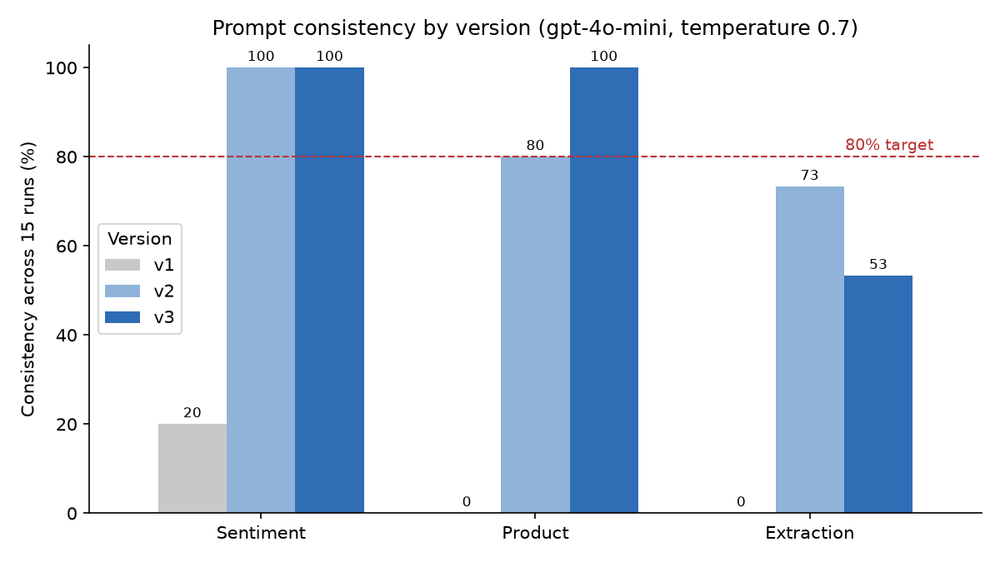

# Failure Analysis Report — TechFlow Solutions prompts

Model `gpt-4o-mini`, temperature 0.7 for every run. Generated by `prompt_engineering_lab.ipynb`; raw responses are in `results/all_runs.json`.

## How consistency is measured

- **Sentiment:** share of runs returning the most common output exactly.
- **Extraction:** share of runs whose parsed JSON equals the most common parsed JSON (unparseable = miss).
- **Product description:** share of runs meeting the full spec (headline, exactly 3 features, 40–110 words, correct price, no invented numbers).

## Consistency by version (15 runs each)

| Task | Version | Technique | Runs | Unique outputs | Consistency % | Meets 80% target |
|---|---|---|---|---|---|---|
| Sentiment | v1 | Zero-shot (client prompt) | 15 | 9 | 20.0 | ❌ |
| Sentiment | v2 | Instructions + format + constraints | 15 | 1 | 100.0 | ✅ |
| Sentiment | v3 | Few-shot (4 examples) + definitions + system role | 15 | 1 | 100.0 | ✅ |
| Product | v1 | Zero-shot (client prompt) | 15 | 15 | 0.0 | ❌ |
| Product | v2 | Instructions + format + constraints | 15 | 15 | 80.0 | ✅ |
| Product | v3 | Few-shot (2 examples) + facts-only rule + JSON | 15 | 15 | 100.0 | ✅ |
| Extraction | v1 | Zero-shot (client prompt) | 15 | 8 | 0.0 | ❌ |
| Extraction | v2 | Instructions + format + constraints | 15 | 3 | 73.3 | ❌ |
| Extraction | v3 | Chain-of-Thought + worked example + enum schema | 15 | 15 | 53.3 | ❌ |

## v1 → v3 improvement (percentage points)

| Task | v1 | v2 | v3 | v1 → v3 (pp) |
|---|---|---|---|---|
| Extraction | 0.0 | 73.3 | 53.3 | 53.3 |
| Product | 0.0 | 80.0 | 100.0 | 100.0 |
| Sentiment | 20.0 | 100.0 | 100.0 | 80.0 |

## v1 diagnosis at 5 / 10 / 15 runs

| Task | Runs | Unique outputs | Consistency % |
|---|---|---|---|
| Sentiment | 5 | 5 | 20.0 |
| Sentiment | 10 | 7 | 20.0 |
| Sentiment | 15 | 9 | 20.0 |
| Product | 5 | 5 | 0.0 |
| Product | 10 | 10 | 0.0 |
| Product | 15 | 15 | 0.0 |
| Extraction | 5 | 3 | 0.0 |
| Extraction | 10 | 9 | 0.0 |
| Extraction | 15 | 8 | 0.0 |

## Documented failure patterns (v1)

### Sentiment
- **No label set given.** The model invents its own categories ('Positive Feedback', 'Customer Satisfaction', 'customer compliment') instead of Positive/Negative/Neutral.
- **Sentence instead of a label.** Every answer is a full sentence ('This customer message can be classified as…'), so nothing can be matched programmatically.
- **Hedging with two labels.** Many runs give two answers ('X or Y'), so there is no single decision.
- **Formatting drift.** Bold, quotes and capitalisation change from run to run, so identical meaning ≠ identical output.

### Product
- **Every run unique.** No two descriptions are the same and length varies widely; there is no defined structure or length.
- **Invented specifications.** With only a name and price, the model fills gaps with made-up facts (range in feet, DPI levels, months of battery) that contradict each other across runs — e.g. battery 'included' vs 'not included'. Publishing this would be false advertising.
- **Too long and markdown-heavy.** Typical output is several hundred words with headings, bold and 5–7 bullets — far too long for a product page block.
- **Inconsistent naming.** The product gets a different invented name almost every run ('Precision', 'Freedom', 'Ergonomic', 'Comfort').

### Extraction
- **Not machine-readable.** Output is a markdown bullet list with a chatty preamble, so a downstream system cannot parse it.
- **No schema.** Field names are chosen by the model ('Order Number' vs 'order_number'), so they can change between runs or inputs.
- **Unnormalised / invented values.** '#12345' vs '12345', 'March 15th' kept as text; when asked for a date format the model invented a year (2023) that is not in the feedback.
- **Looks stable on easy input.** On this short, explicit sentence the content is fairly stable — the failure is format, not understanding. Harder inputs (Part 5) expose content errors.

## Task variations (Step 12)

### Sentiment (5 runs per message)

| case | expected | v2 accuracy_% | v2 consistency_% | v3 accuracy_% | v3 consistency_% |
|---|---|---|---|---|---|
| sarcasm | Negative | 100.0 | 100.0 | 100.0 | 100.0 |
| mixed | Negative | 0.0 | 100.0 | 100.0 | 100.0 |
| question | Neutral | 100.0 | 100.0 | 100.0 | 100.0 |
| factual | Neutral | 0.0 | 100.0 | 100.0 | 100.0 |
| understated | Positive | 100.0 | 100.0 | 100.0 | 100.0 |
| negation | Positive | 100.0 | 100.0 | 60.0 | 60.0 |
| Spanish | Negative | 100.0 | 100.0 | 100.0 | 100.0 |
| gratitude | Positive | 100.0 | 100.0 | 100.0 | 100.0 |

### Extraction (5 runs per feedback)

| case | v2 consistency_% | v2 schema_valid_% | v2 field_accuracy_% | v3 consistency_% | v3 schema_valid_% | v3 field_accuracy_% |
|---|---|---|---|---|---|---|
| late + defective + refund | 60.0 | 100.0 | 80.0 | 80.0 | 80.0 | 93.3 |
| no order id, mixed | 60.0 | 100.0 | 40.0 | 100.0 | 100.0 | 100.0 |
| positive, no issues | 60.0 | 100.0 | 66.7 | 100.0 | 100.0 | 100.0 |
| wrong item, date without year | 60.0 | 100.0 | 100.0 | 100.0 | 100.0 | 100.0 |
